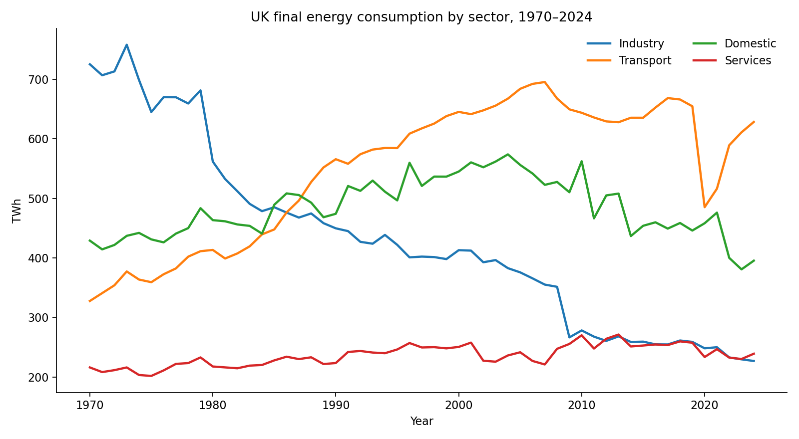
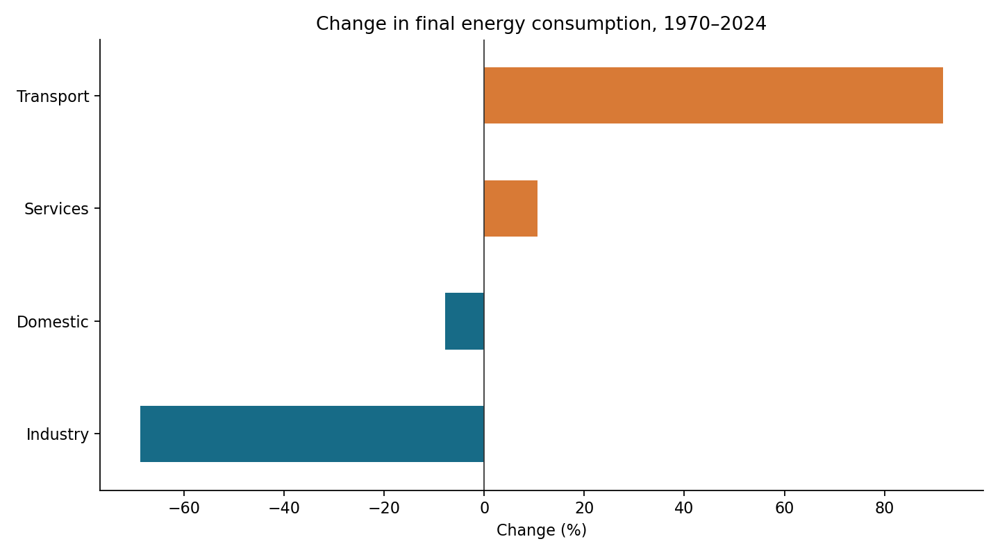

# UK Energy Consumption Forecasting — MSc Dissertation

This repository presents the independently verified historical analysis, the documented methodology and the reported findings from my MSc dissertation, **Predicting UK Renewable and Non-Renewable Energy Consumption Using Machine Learning**. Some original modelling artefacts are not currently available, so unsupported numerical outputs have intentionally not been reproduced.

## Research question

How did UK energy consumption change between **1970 and 2024**, and how do ARIMA, Random Forest and XGBoost compare as approaches to forecasting renewable and non-renewable consumption?

## Data and preparation

The report uses DESNZ's *Energy Consumption in the UK* data, World Bank GDP/population indicators and UK Met Office temperature/rainfall series. It describes restructuring sector/fuel tables, handling missing values, aligning annual observations and joining indicators by year. The original transformed modelling dataset has not been recovered, so complete predictor coverage and the exact target construction remain unverified.

The reproducible analysis in this repository retains original ktoe units, preserves missing values and source-cell references, and checks unique keys and sector reconciliation. Its outputs are distinct from the report's forecasting experiments.

## Models, evaluation and findings

The report compares an **ARIMA** baseline with **Random Forest** and **XGBoost** regressors using **MAE, RMSE and MAPE**. It describes cross-validation and hyperparameter tuning for the tree models. **XGBoost was reported as the strongest-performing approach**; the report attributes this to modelling nonlinear relationships and feature interactions.

The report describes different time-based and shuffled/random evaluation arrangements, so this is a reported conclusion rather than an independently reproduced, matched out-of-time comparison. No unsupported model scores, R² values or exact future predictions are presented.

## Practical relevance and limitations

The study connects historical demand analysis with forecasting methods relevant to energy planning. It demonstrates research framing, Python/SQL analysis, visual communication and critical evaluation; no implemented policy or business impact is claimed.

Original forecasting code, split indices and saved predictions are not currently available. Report unit conversions, renewable-target definitions, future-period descriptions and plot/table consistency require reconciliation before numerical forecasting results can be released. The complete dissertation and restricted university material are excluded.

Read the [methodology and verification notes](docs/DISSERTATION-SUMMARY.md), then explore the independently reproduced historical findings below.

## Findings

- Total final consumption fell **12.3%** between 1970 and 2024.
- Consumption increased **2.6%** from 2023 to 2024.
- Transport represented **42.2%** of final consumption in 2024, making it a useful focus for further demand research.





## Worked example: long-term demand

**Question:** How much did total final consumption change from 1970 to 2024?

```sql
SELECT year, consumption_ktoe
FROM energy
WHERE sector = 'All final users' AND fuel = 'Total'
  AND year IN (1970, 2024)
ORDER BY year;
```

**Result:** 145,977 ktoe in 1970 and 128,091.8 ktoe in 2024, a **12.3% decline**. Calculate `(2024 value / 1970 value - 1) * 100`; do not sum the aggregate sector with its components. The in-memory energy table is populated in `src/analyze.py`.

**Interpretation:** overall demand declined across these endpoints. The comparison alone cannot identify the contributions of efficiency, weather or economic structure. [Full SQL comparison](sql/sector_changes.sql).

## Reading the results

Start with [findings and limitations](reports/findings.md), then use [computed metrics](reports/metrics.json) to check the headline results. The [tidy data](reports/energy_tidy.csv) retains source-cell references for tracing figures back to Table C1.

When comparing sectors, keep `All final users` separate from its component sectors to avoid double-counting. Use ktoe consistently, or convert every value using **1 ktoe = 0.01163 TWh**. Read missing fuel values as unavailable, not as zero. Check the [validation run](https://github.com/Kelv-Ojo/uk-energy-analysis/actions/workflows/validate.yml) before relying on regenerated outputs.

## Reproduce

From this repository's root, using Python 3.10 or later:

```bash
python -m venv .venv
source .venv/bin/activate
python -m pip install -r requirements.txt
python src/analyze.py
```

Windows: activate with `.venv\Scripts\activate`. The source workbook is included; no API key or external service is needed. Outputs are regenerated in `reports/`.

## Analytical decisions

- Read only the relevant area of Table C1, rather than the workbook's inflated formatted range.
- Retain source cell references, missing-value status and original ktoe units in the tidy dataset.
- Correct unit conversion: **1 ktoe = 0.01163 TWh**. The earlier notebook omitted the thousands factor when converting to kWh.
- Use reported totals for comparisons. Never sum the aggregate `All final users` with individual sectors.
- Preserve missing fuel values, including `[x]`, rather than assuming zero.
- Validate 55 consecutive years, unique keys, complete totals, nonnegative values and sector reconciliation. Published rounding causes at most a 2 ktoe sector-sum difference.

## Explore the work

- [Analysis code](src/analyze.py)
- [SQL endpoint comparison](sql/sector_changes.sql)
- [Findings and limitations](reports/findings.md)
- [Tidy dataset with source cells](reports/energy_tidy.csv)
- [Computed metrics](reports/metrics.json)
- [Input SHA-256 fingerprint](data/manifest.json)

## Source and limits

[DESNZ: Energy consumption in the UK 2025](https://www.gov.uk/government/statistics/energy-consumption-in-the-uk-2025), Table C1, 1970–2024. The included local workbook snapshot is fingerprinted in the manifest; this is not a claim to use the newest release. Government data is attributed under the [Open Government Licence v3.0](https://www.nationalarchives.gov.uk/doc/open-government-licence/version/3/).

These are descriptive comparisons, not causal estimates or forecasts. Weather, economic activity and efficiency could explain changes but are not measured here. Electricity consumption does not identify renewable generation. This project does not claim emissions reductions, client work or commercial impact.

## Automated validation

[Validation runs](https://github.com/Kelv-Ojo/uk-energy-analysis/actions/workflows/validate.yml) rebuild the analysis and check source fingerprints and fixed-snapshot totals. See [reproduction instructions and dependency pins](REPRODUCIBILITY.md). Python checks do not certify native Excel or Power BI behaviour.


## Portfolio review notes

This repository reproduces descriptive historical analysis, not the dissertation's forecasting experiments. A recovered MSc report describes ARIMA, Random Forest and XGBoost, but its absolute unit scale, renewable grouping, evaluation splits and forecast figure/table consistency need resolution. Its tables end in 2029 despite a 2030 aim. Do not relabel the historical charts as forecasts or add model scores to this README as independently reproduced results. Recover the original pipeline before extending this repository.

## Business context and skills

Energy planning starts with trustworthy historical demand comparisons. This repository checks the historical data and distinguishes it from the related report-described forecasting study.

**Skills demonstrated:** Python and SQL; source-cell tracing; unit validation; time-series visualisation; critical review of model evaluation.
