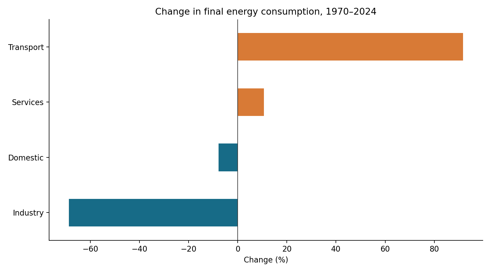

# UK Energy Consumption Analysis

**Question:** How has UK final energy consumption changed across sectors between 1970 and 2024, and where should further demand analysis focus?

An analysis of the DESNZ Energy Consumption in the UK 2025 workbook, developed from my existing energy project with assisted code and documentation improvements. It demonstrates source inspection, reproducible cleaning, SQL comparisons, unit validation and communication of findings.

## Findings

- Total final consumption fell **12.3%** between 1970 and 2024.
- Consumption increased **2.6%** from 2023 to 2024.
- Transport represented **42.2%** of final consumption in 2024, making it a useful focus for further demand research.




## Worked example: long-term demand

**Question:** How much did total final consumption change from 1970 to 2024?

```sql
SELECT year, consumption_ktoe
FROM energy
WHERE sector = 'All final users' AND fuel = 'Total'
  AND year IN (1970, 2024)
ORDER BY year;
```

**Result:** 145,977 ktoe in 1970 and 128,091.8 ktoe in 2024, a **12.3% decline**. Calculate `(2024 value / 1970 value - 1) * 100`; do not sum the aggregate sector with its components. The in-memory energy table is populated in `src/analyze.py`.

**Interpretation:** overall demand declined across these endpoints. The comparison alone cannot identify the contributions of efficiency, weather or economic structure. [Full SQL comparison](sql/sector_changes.sql).

## Reading the results

Start with [findings and limitations](reports/findings.md), then use [computed metrics](reports/metrics.json) to check the headline results. The [tidy data](reports/energy_tidy.csv) retains source-cell references for tracing figures back to Table C1.

When comparing sectors, keep `All final users` separate from its component sectors to avoid double-counting. Use ktoe consistently, or convert every value using **1 ktoe = 0.01163 TWh**. Read missing fuel values as unavailable, not as zero. Check the [validation run](https://github.com/Kelv-Ojo/uk-energy-analysis/actions/workflows/validate.yml) before relying on regenerated outputs.

## Reproduce

From this repository's root, using Python 3.10 or later:

```bash
python -m venv .venv
source .venv/bin/activate
python -m pip install -r requirements.txt
python src/analyze.py
```

Windows: activate with `.venv\Scripts\activate`. The source workbook is included; no API key or external service is needed. Outputs are regenerated in `reports/`.

## Analytical decisions

- Read only the relevant area of Table C1, rather than the workbook's inflated formatted range.
- Retain source cell references, missing-value status and original ktoe units in the tidy dataset.
- Correct unit conversion: **1 ktoe = 0.01163 TWh**. The earlier notebook omitted the thousands factor when converting to kWh.
- Use reported totals for comparisons. Never sum the aggregate `All final users` with individual sectors.
- Preserve missing fuel values, including `[x]`, rather than assuming zero.
- Validate 55 consecutive years, unique keys, complete totals, nonnegative values and sector reconciliation. Published rounding causes at most a 2 ktoe sector-sum difference.

## Explore the work

- [Analysis code](src/analyze.py)
- [SQL endpoint comparison](sql/sector_changes.sql)
- [Findings and limitations](reports/findings.md)
- [Tidy dataset with source cells](reports/energy_tidy.csv)
- [Computed metrics](reports/metrics.json)
- [Input SHA-256 fingerprint](data/manifest.json)

## Source and limits

[DESNZ: Energy consumption in the UK 2025](https://www.gov.uk/government/statistics/energy-consumption-in-the-uk-2025), Table C1, 1970–2024. The included local workbook snapshot is fingerprinted in the manifest; this is not a claim to use the newest release. Government data is attributed under the [Open Government Licence v3.0](https://www.nationalarchives.gov.uk/doc/open-government-licence/version/3/).

These are descriptive comparisons, not causal estimates or forecasts. Weather, economic activity and efficiency could explain changes but are not measured here. Electricity consumption does not identify renewable generation. This project does not claim emissions reductions, client work or commercial impact.

## Automated validation

[Validation runs](https://github.com/Kelv-Ojo/uk-energy-analysis/actions/workflows/validate.yml) rebuild the analysis and check source fingerprints and fixed-snapshot totals. See [reproduction instructions and dependency pins](REPRODUCIBILITY.md). Python checks do not certify native Excel or Power BI behaviour.
