# MSc dissertation visual gallery

14 source-checked figures and 49 distinct recovered display images. The document contains 32 appendix captions (including repeated numbering and shared panels), 33 approved body/appendix visual assets, and the notebook has 29 saved PNG outputs. Exact notebook bytes and source references are retained in the inventory.

## How to read this gallery

**Verified historical analysis** uses the fingerprinted ECUK 2025 source with corrected units and missing values preserved. **Verified separate historical backtest** uses a different total-consumption target and does not reproduce the dissertation. **Original research figure; not reproduced** is an unchanged recovered image: its presence verifies provenance, not model accuracy.

[Machine-readable inventory](dissertation-visual-inventory.json) · [Chart data](../reports/gallery-chart-data.json) · [Target/unit audit](TARGET-RECONCILIATION.md) · [Notebook evaluation audit](RECOVERED-NOTEBOOK-AUDIT.md)

Original charts retain their historical labels, including the disputed Renewable grouping and incorrect kWh scale. Read the caption on each image. No original forecast value, feature importance, model score or future scenario is promoted as independently validated. The full dissertation, ethics documents, declarations, feedback and institutional branding are not published.

## Verified historical analysis and separate backtest

### Final consumption by sector

**Verified historical analysis**

[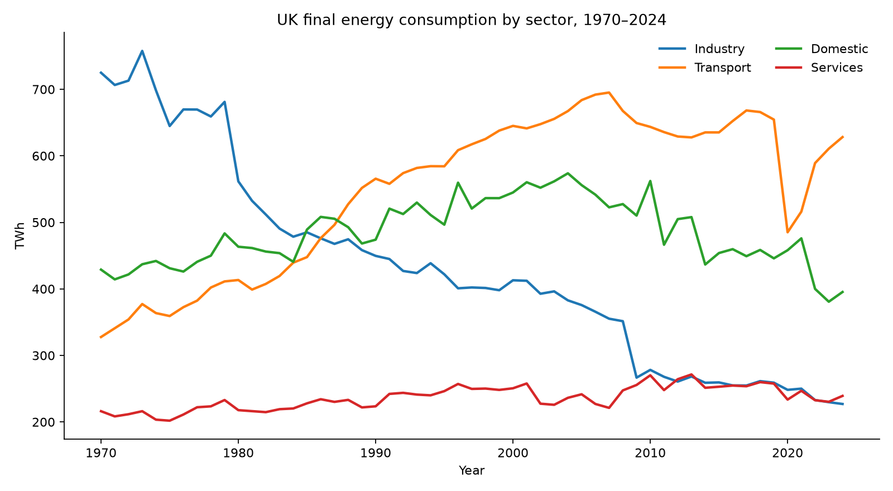](../assets/dissertation-gallery/verified/sector-trends.png)

Existing source-checked historical chart, reused unchanged. Original ktoe converted to TWh where shown; no forecasting claim.

### Sector changes from 1970 to 2024

**Verified historical analysis**

[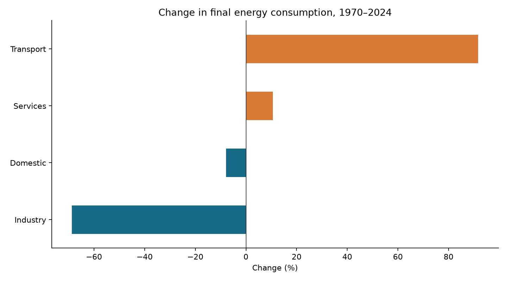](../assets/dissertation-gallery/verified/sector-changes.png)

Existing source-checked historical chart, reused unchanged. Original ktoe converted to TWh where shown; no forecasting claim.

### Industry fuel breakdown

**Verified historical analysis**

[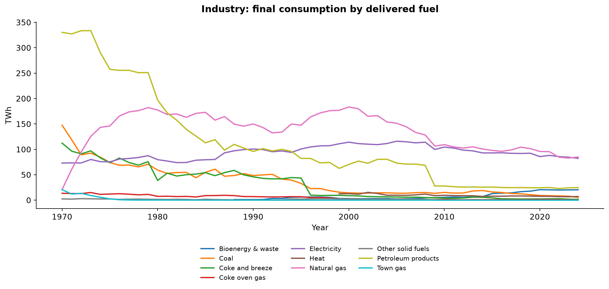](../assets/dissertation-gallery/verified/industry-fuels.png)

Table C1 sector-specific fuel series, 1970–2024. Missing observations remain gaps. Delivered fuels are not a renewable/non-renewable classification; lines are not summed into a new total.

### Transport fuel breakdown

**Verified historical analysis**

[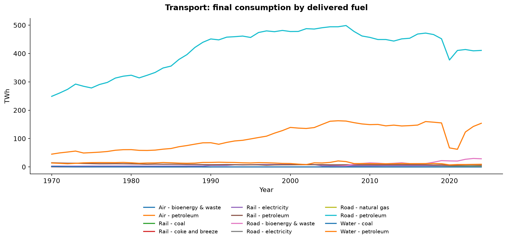](../assets/dissertation-gallery/verified/transport-fuels.png)

Table C1 sector-specific fuel series, 1970–2024. Missing observations remain gaps. Delivered fuels are not a renewable/non-renewable classification; lines are not summed into a new total.

### Domestic fuel breakdown

**Verified historical analysis**

[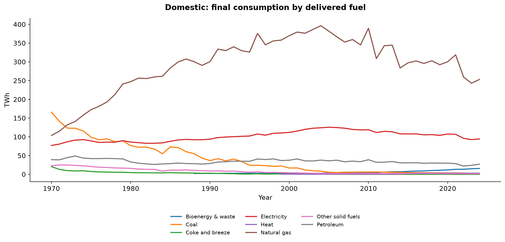](../assets/dissertation-gallery/verified/domestic-fuels.png)

Table C1 sector-specific fuel series, 1970–2024. Missing observations remain gaps. Delivered fuels are not a renewable/non-renewable classification; lines are not summed into a new total.

### Services fuel breakdown

**Verified historical analysis**

[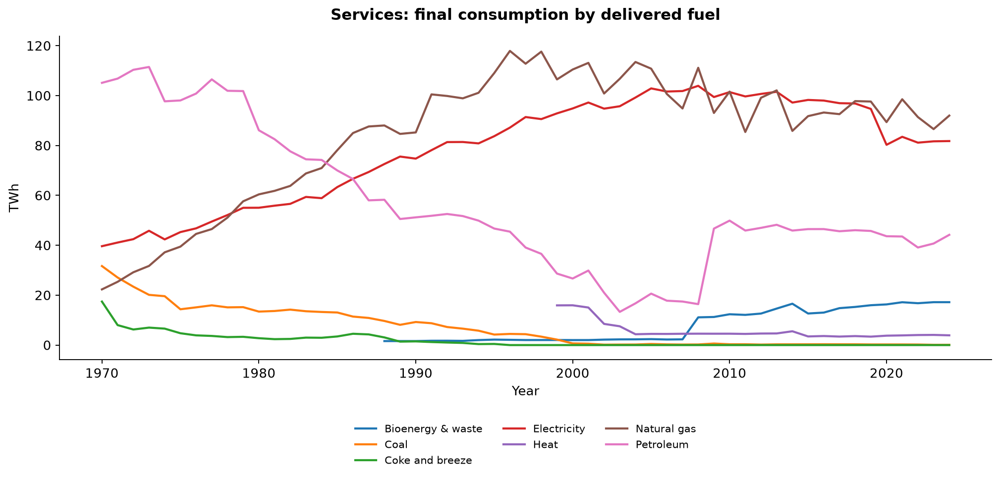](../assets/dissertation-gallery/verified/services-fuels.png)

Table C1 sector-specific fuel series, 1970–2024. Missing observations remain gaps. Delivered fuels are not a renewable/non-renewable classification; lines are not summed into a new total.

### National fuel comparisons

**Verified historical analysis**

[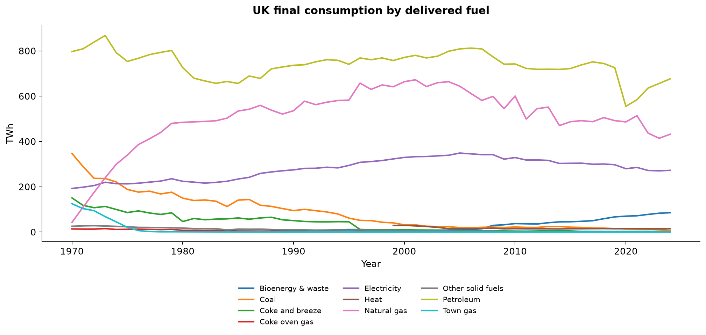](../assets/dissertation-gallery/verified/national-fuels.png)

All final users only; component sectors are not added again. Missing values remain gaps. The reported total has scope adjustments and need not equal the visible fuel sum.

### Fuel snapshots in 1970, 2000 and 2024

**Verified historical analysis**

[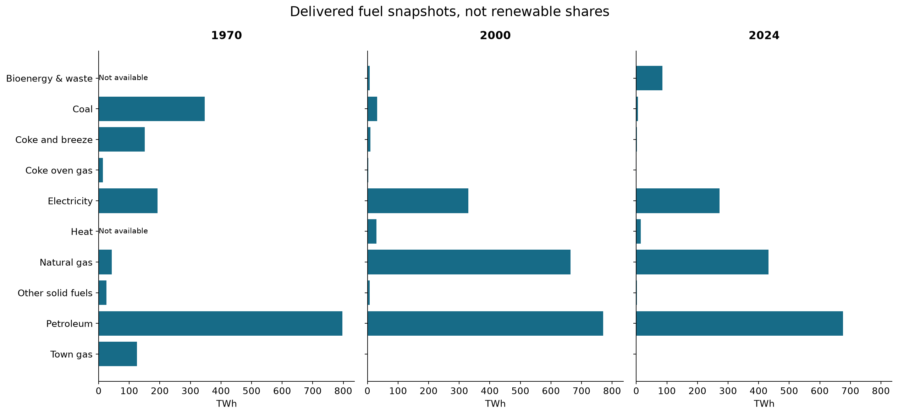](../assets/dissertation-gallery/verified/fuel-snapshots.png)

Absolute consumption in TWh. Unavailable categories are explicitly labelled, not assigned zero. No pie normalisation conceals missing or out-of-scope fuel components.

### Year-on-year sector changes

**Verified historical analysis**

[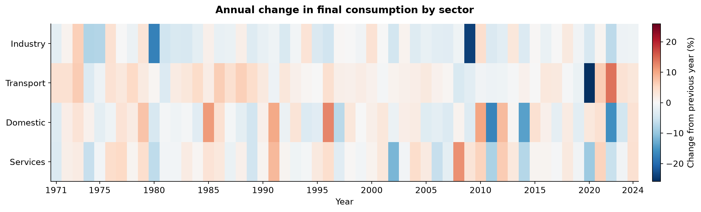](../assets/dissertation-gallery/verified/sector-yoy.png)

Changes calculated from reported sector totals, 1971–2024. A descriptive annual comparison; no attribution to weather, policy or efficiency is inferred.

### Annual sector correlation

**Verified historical analysis**

[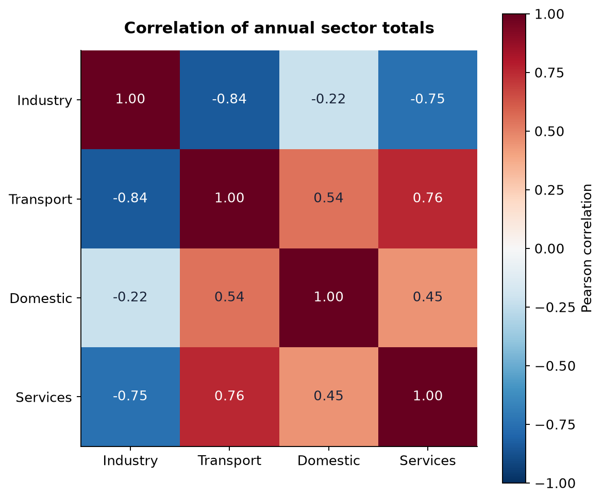](../assets/dissertation-gallery/verified/annual-sector-correlation.png)

55 annual observations, 1970–2024. This is not the original notebook matrix, which correlated aggregated fuel profiles across sectors. Co-trending levels and autocorrelation limit interpretation; no causal claim.

### Major fuel trajectories

**Verified historical analysis**

[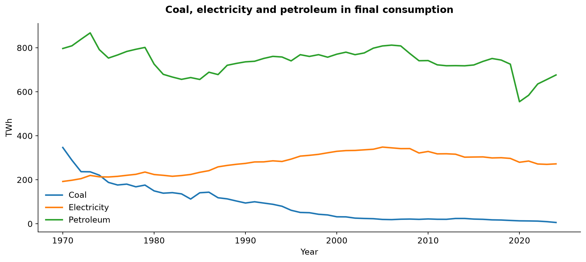](../assets/dissertation-gallery/verified/major-fuels.png)

National delivered-fuel categories from All final users. Unlike an all-sector sum, this does not count aggregate and component sectors together.

### Matched chronological model comparison

**Verified separate historical backtest**

[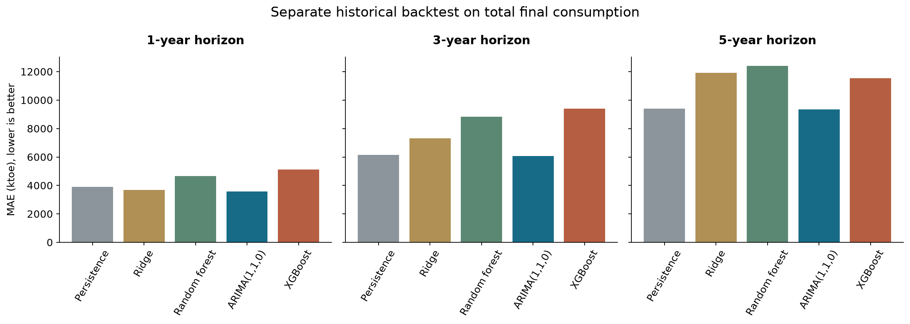](../assets/dissertation-gallery/verified/backtest-model-comparison.png)

New total-consumption experiment, not dissertation reproduction. The same 22/20/18 origin-target pairs are used at 1/3/5-year horizons. Fixed ARIMA has the lowest error here; no statistical significance is claimed.

### Actual versus predicted on matched years

**Verified separate historical backtest**

[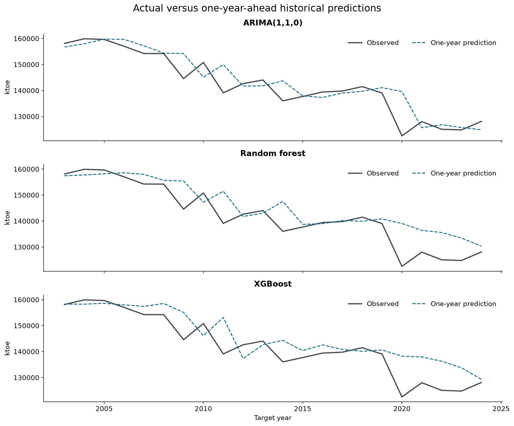](../assets/dissertation-gallery/verified/backtest-actual-predicted.png)

22 one-year forecasts per model for target years 2003–2024. Current-vintage annual observations are assumed available at each origin. No future exogenous data or original dissertation target groups are used.

### Historical forecast uncertainty diagnostic

**Verified separate historical backtest; exploratory uncertainty**

[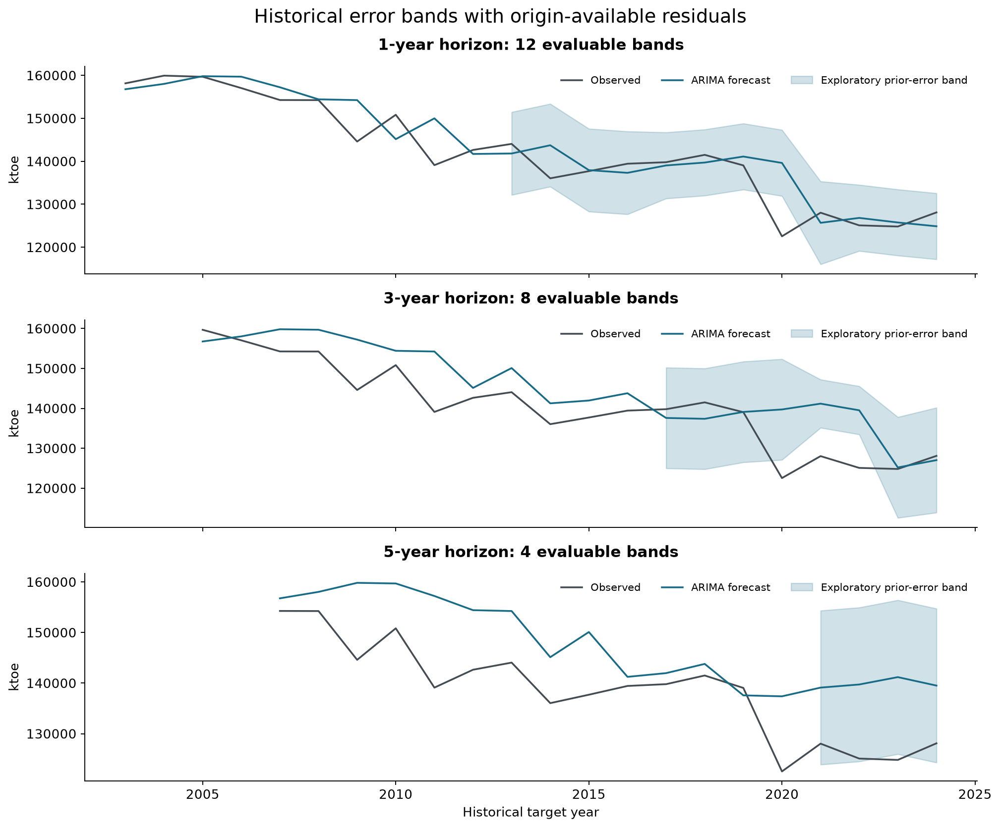](../assets/dissertation-gallery/verified/historical-error-bands.png)

Nominal 80% prior-error bands, withheld until ten errors have matured. Only 12/8/4 bands per model are evaluable. Longer-horizon undercoverage and dependent errors prevent a calibrated 80% coverage claim; no future forecast is shown.

## Recovered dissertation figures

Expand a subject to view its original figures. Click any image for full resolution.

Original historical exploration (12)

### Sector consumption trends

**Original research figure; not reproduced**

[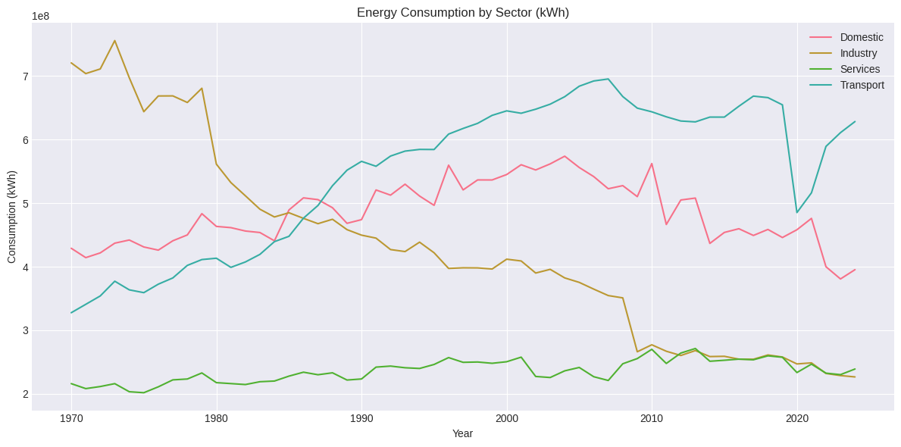](../assets/dissertation-gallery/original/dissertation-16.png)

Original figure, not reproduced. The notebook mislabels ktoe × 11,630 as kWh and some preparation fills missing cells with zero or merges fuel categories. See the separately validated charts for corrected units and scope.

Dissertation rId16; paragraph(s) 170, 603. 

### Domestic fuel breakdown

**Original research figure; not reproduced**

[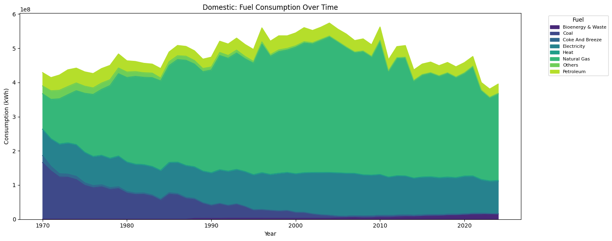](../assets/dissertation-gallery/original/dissertation-17.png)

Original figure, not reproduced. The notebook mislabels ktoe × 11,630 as kWh and some preparation fills missing cells with zero or merges fuel categories. See the separately validated charts for corrected units and scope.

Dissertation rId17; paragraph(s) 203, 605. Notebook cell 34, output 0. 

### Industry fuel breakdown

**Original research figure; not reproduced**

[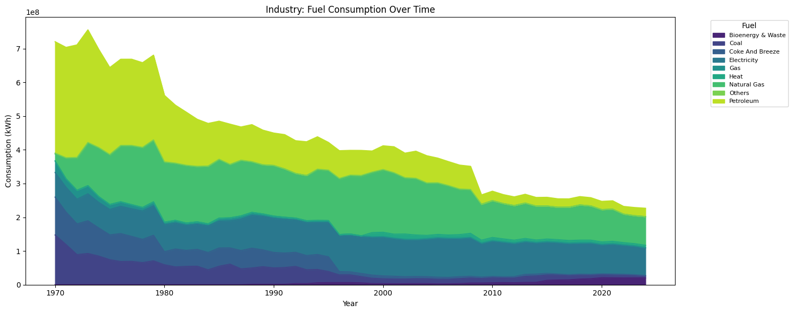](../assets/dissertation-gallery/original/dissertation-18.png)

Original figure, not reproduced. The notebook mislabels ktoe × 11,630 as kWh and some preparation fills missing cells with zero or merges fuel categories. See the separately validated charts for corrected units and scope.

Dissertation rId18; paragraph(s) 213, 609. Notebook cell 34, output 1. 

### Services fuel breakdown

**Original research figure; not reproduced**

[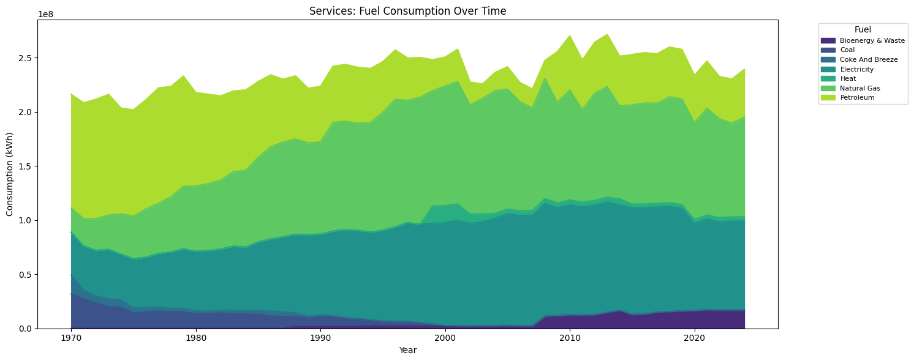](../assets/dissertation-gallery/original/dissertation-19.png)

Original figure, not reproduced. The notebook mislabels ktoe × 11,630 as kWh and some preparation fills missing cells with zero or merges fuel categories. See the separately validated charts for corrected units and scope.

Dissertation rId19; paragraph(s) 222, 612. Notebook cell 34, output 2. 

### Transport fuel breakdown

**Original research figure; not reproduced**

[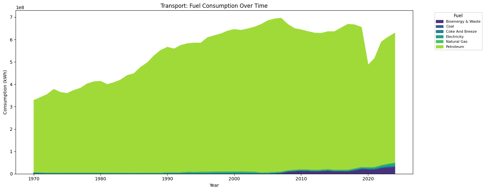](../assets/dissertation-gallery/original/dissertation-20.png)

Original figure, not reproduced. The notebook mislabels ktoe × 11,630 as kWh and some preparation fills missing cells with zero or merges fuel categories. See the separately validated charts for corrected units and scope.

Dissertation rId20; paragraph(s) 232, 614. Notebook cell 34, output 3. 

### National fuel consumption

**Original research figure; not reproduced**

[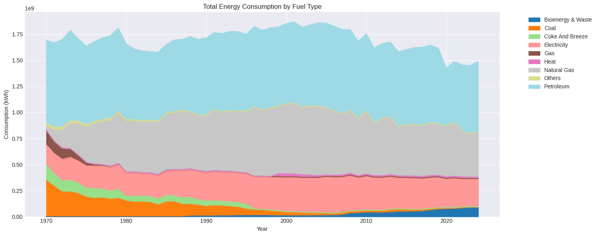](../assets/dissertation-gallery/original/dissertation-21.png)

Original figure, not reproduced. The notebook mislabels ktoe × 11,630 as kWh and some preparation fills missing cells with zero or merges fuel categories. See the separately validated charts for corrected units and scope.

Dissertation rId21; paragraph(s) 242, 616. 

### Fuel mix in 1970

**Original research figure; not reproduced**

[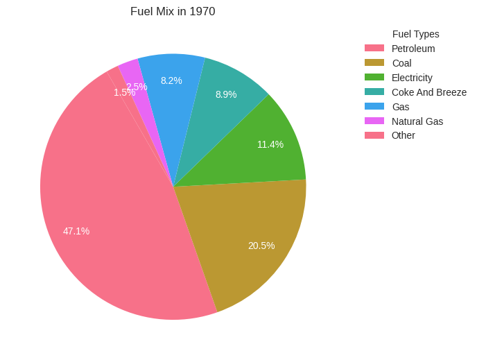](../assets/dissertation-gallery/original/dissertation-22.png)

Original figure, not reproduced. The notebook mislabels ktoe × 11,630 as kWh and some preparation fills missing cells with zero or merges fuel categories. See the separately validated charts for corrected units and scope.

Dissertation rId22; paragraph(s) 251, 619. 

### Fuel mix in 2000

**Original research figure; not reproduced**

[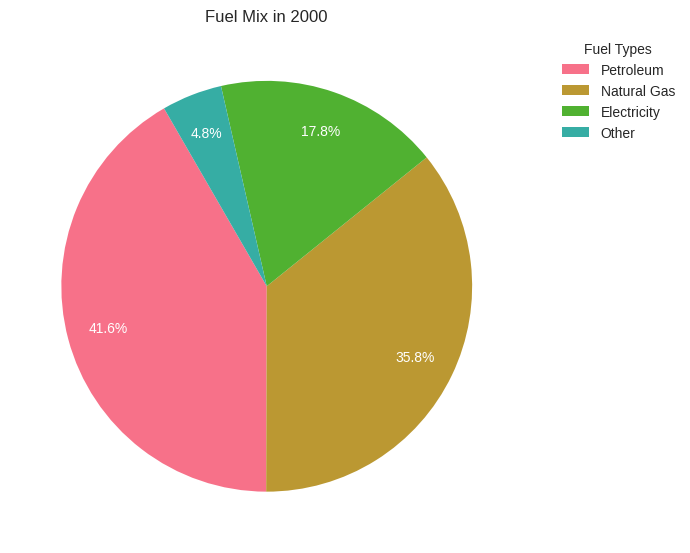](../assets/dissertation-gallery/original/dissertation-23.png)

Original figure, not reproduced. The notebook mislabels ktoe × 11,630 as kWh and some preparation fills missing cells with zero or merges fuel categories. See the separately validated charts for corrected units and scope.

Dissertation rId23; paragraph(s) 251, 621. 

### Fuel mix in 2024

**Original research figure; not reproduced**

[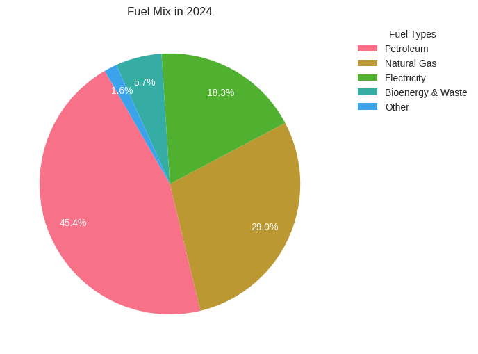](../assets/dissertation-gallery/original/dissertation-24.png)

Original figure, not reproduced. The notebook mislabels ktoe × 11,630 as kWh and some preparation fills missing cells with zero or merges fuel categories. See the separately validated charts for corrected units and scope.

Dissertation rId24; paragraph(s) 252, 624. 

### Year-on-year sector changes

**Original research figure; not reproduced**

[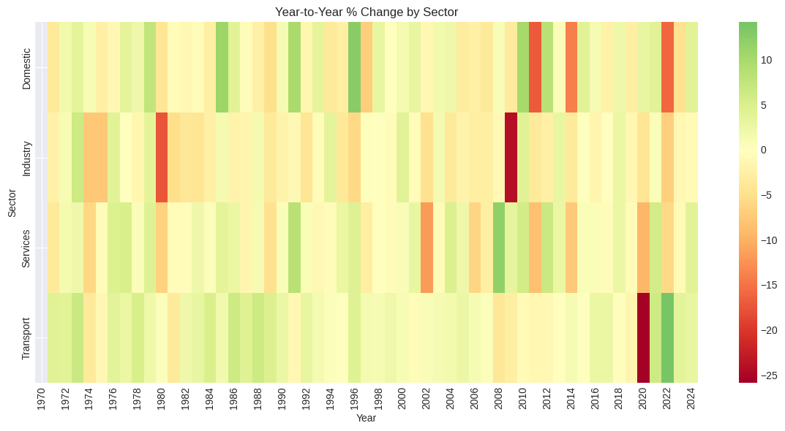](../assets/dissertation-gallery/original/dissertation-25.png)

Original figure, not reproduced. The notebook mislabels ktoe × 11,630 as kWh and some preparation fills missing cells with zero or merges fuel categories. See the separately validated charts for corrected units and scope.

Dissertation rId25; paragraph(s) 258, 626. 

### Correlation across aggregated fuel profiles

**Original research figure; not reproduced**

[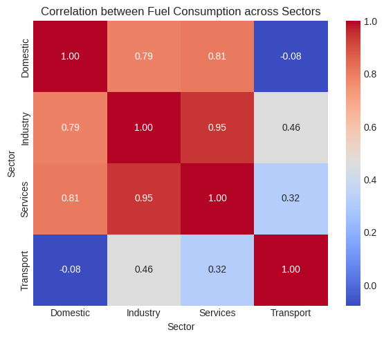](../assets/dissertation-gallery/original/dissertation-26.png)

Original figure, not reproduced. The notebook mislabels ktoe × 11,630 as kWh and some preparation fills missing cells with zero or merges fuel categories. See the separately validated charts for corrected units and scope.

Dissertation rId26; paragraph(s) 265, 628. 

### Major fuel trends

**Original research figure; not reproduced**

[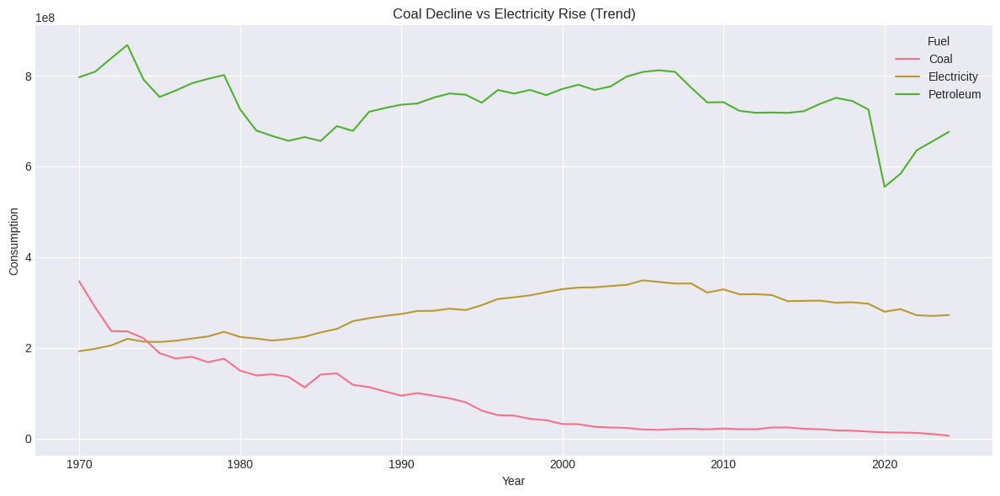](../assets/dissertation-gallery/original/dissertation-27.png)

Original figure, not reproduced. The notebook mislabels ktoe × 11,630 as kWh and some preparation fills missing cells with zero or merges fuel categories. See the separately validated charts for corrected units and scope.

Dissertation rId27; paragraph(s) 270, 630. 

Original feature exploration (5)

### GDP and the two original target groups

**Original research figure; not reproduced**

[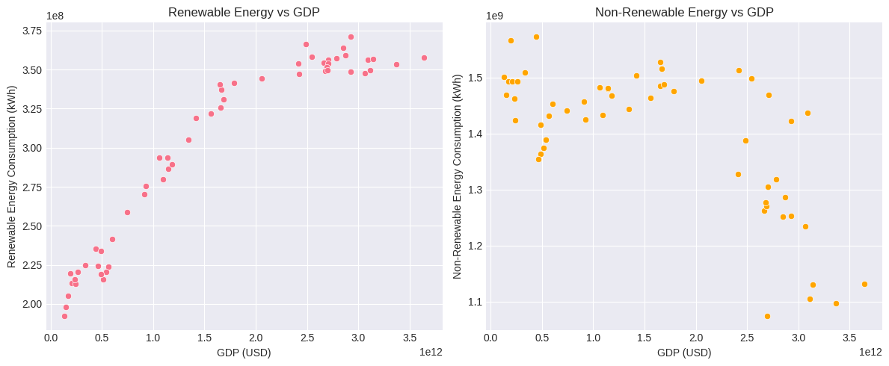](../assets/dissertation-gallery/original/dissertation-28.png)

Original figure, not reproduced. The Renewable label combines all electricity with bioenergy and waste; this is not measured renewable consumption. Original predictor indicator/vintage files are missing. Correlation is not causation.

Dissertation rId28; paragraph(s) 284, 290, 632, 635. 

### Population and the two original target groups

**Original research figure; not reproduced**

[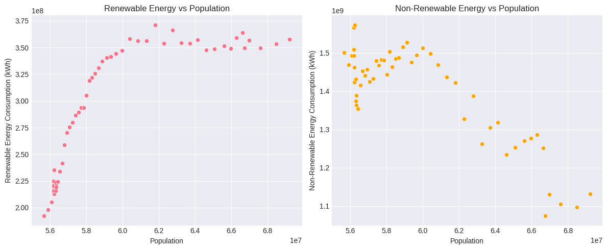](../assets/dissertation-gallery/original/dissertation-29.png)

Original figure, not reproduced. The Renewable label combines all electricity with bioenergy and waste; this is not measured renewable consumption. Original predictor indicator/vintage files are missing. Correlation is not causation.

Dissertation rId29; paragraph(s) 297, 303, 637, 639. 

### Temperature and the two original target groups

**Original research figure; not reproduced**

[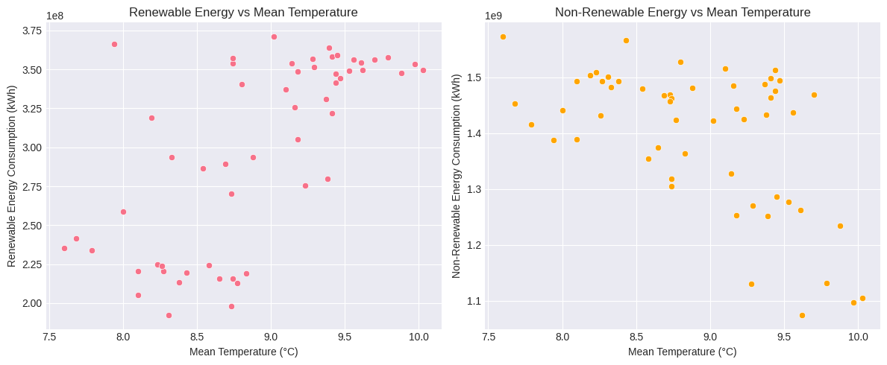](../assets/dissertation-gallery/original/dissertation-30.png)

Original figure, not reproduced. The Renewable label combines all electricity with bioenergy and waste; this is not measured renewable consumption. Original predictor indicator/vintage files are missing. Correlation is not causation.

Dissertation rId30; paragraph(s) 320, 327, 642, 644. 

### Rainfall and the two original target groups

**Original research figure; not reproduced**

[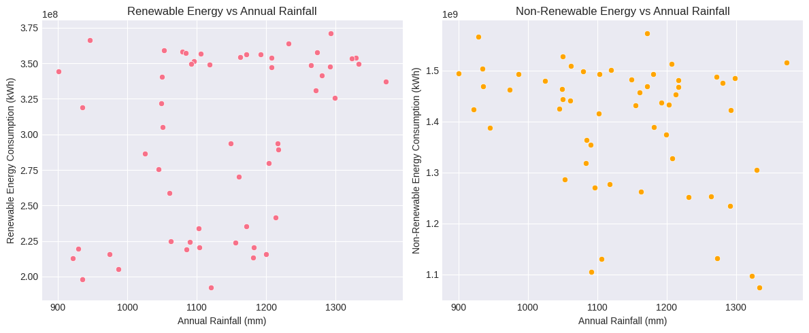](../assets/dissertation-gallery/original/dissertation-31.png)

Original figure, not reproduced. The Renewable label combines all electricity with bioenergy and waste; this is not measured renewable consumption. Original predictor indicator/vintage files are missing. Correlation is not causation.

Dissertation rId31; paragraph(s) 333, 339, 646, 648. 

### Original feature correlation matrix

**Original research figure; not reproduced**

[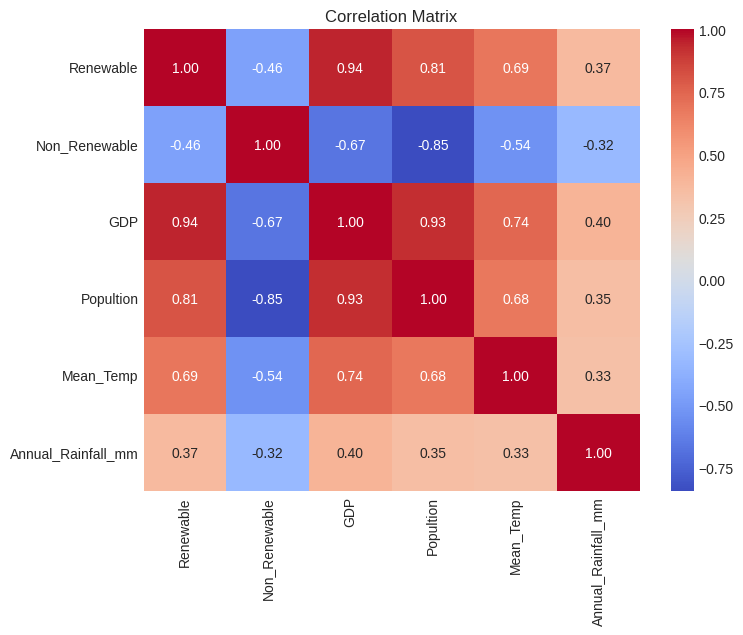](../assets/dissertation-gallery/original/dissertation-32.png)

Original figure, not reproduced. The Renewable label combines all electricity with bioenergy and waste; this is not measured renewable consumption. Original predictor indicator/vintage files are missing. Correlation is not causation.

Dissertation rId32; paragraph(s) 352, 650. 

Original data and pipeline artefacts (2)

### Joined modelling data preview

**Original research figure; not reproduced**

[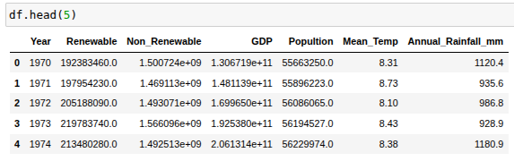](../assets/dissertation-gallery/original/dissertation-14.png)

Original research artefact, not a verified modelling dataset or successful reproduction. Original target labels and units remain disputed; original input snapshots are incomplete.

Dissertation rId14; paragraph(s) 165, 601. 

### Original XGBoost pipeline diagram

**Original research figure; not reproduced**

[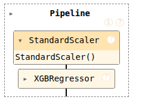](../assets/dissertation-gallery/original/dissertation-37.png)

Original research artefact, not a verified modelling dataset or successful reproduction. Original target labels and units remain disputed; original input snapshots are incomplete.

Dissertation rId37; paragraph(s) 448. 

Original model diagnostics (7)

### Random Forest historical and test predictions

**Original research figure; not reproduced**

[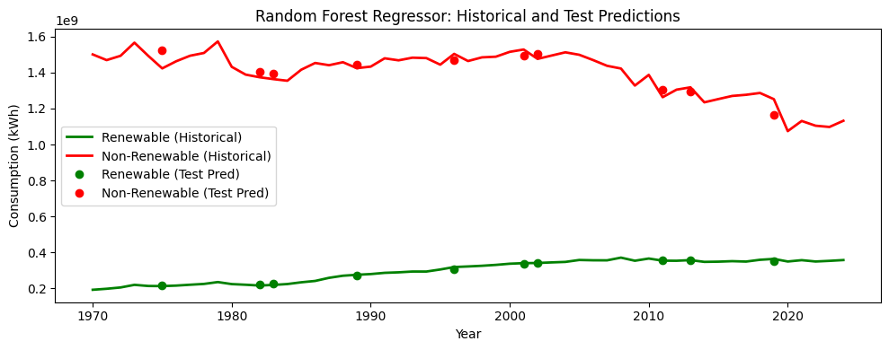](../assets/dissertation-gallery/original/dissertation-34.png)

Original saved result, not reproduced. Targets and absolute unit scale need correction; ARIMA and tree-model splits are not matched. Shuffled holdouts, tuning and predictor timing prevent an independently verified model ranking. Feature importance is model-specific association, not causal influence.

Dissertation rId34; paragraph(s) 433. Notebook cell 121, output 0. 

### Random Forest actual versus predicted

**Original research figure; not reproduced**

[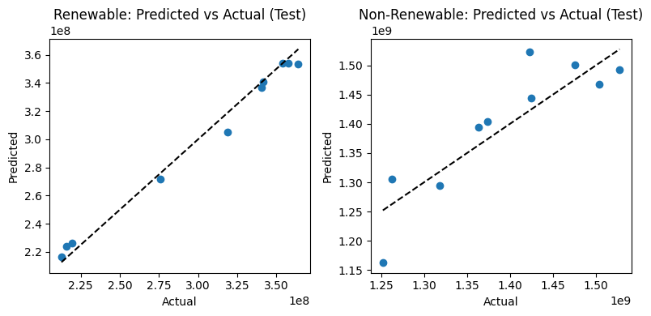](../assets/dissertation-gallery/original/dissertation-35.png)

Original saved result, not reproduced. Targets and absolute unit scale need correction; ARIMA and tree-model splits are not matched. Shuffled holdouts, tuning and predictor timing prevent an independently verified model ranking. Feature importance is model-specific association, not causal influence.

Dissertation rId35; paragraph(s) 435, 656. Notebook cell 123, output 0. 

### Random Forest feature importance

**Original research figure; not reproduced**

[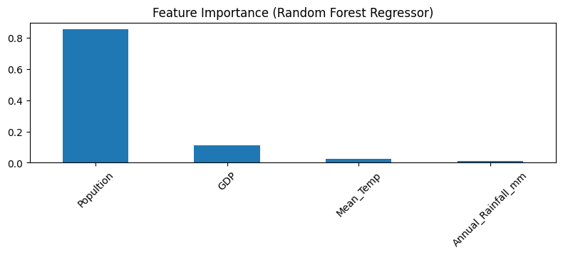](../assets/dissertation-gallery/original/dissertation-36.png)

Original saved result, not reproduced. Targets and absolute unit scale need correction; ARIMA and tree-model splits are not matched. Shuffled holdouts, tuning and predictor timing prevent an independently verified model ranking. Feature importance is model-specific association, not causal influence.

Dissertation rId36; paragraph(s) 438, 658. 

### XGBoost learning curves

**Original research figure; not reproduced**

[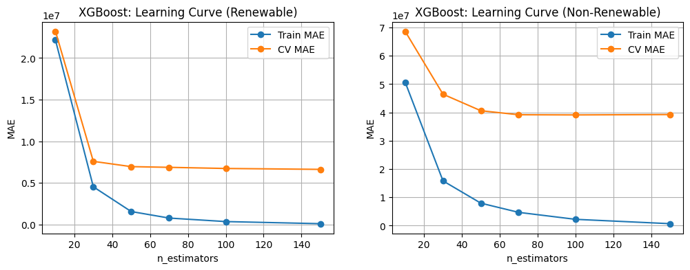](../assets/dissertation-gallery/original/dissertation-38.png)

Original saved result, not reproduced. Targets and absolute unit scale need correction; ARIMA and tree-model splits are not matched. Shuffled holdouts, tuning and predictor timing prevent an independently verified model ranking. Feature importance is model-specific association, not causal influence.

Dissertation rId38; paragraph(s) 466, 664. Notebook cell 156, output 0. 

### XGBoost historical and test predictions

**Original research figure; not reproduced**

[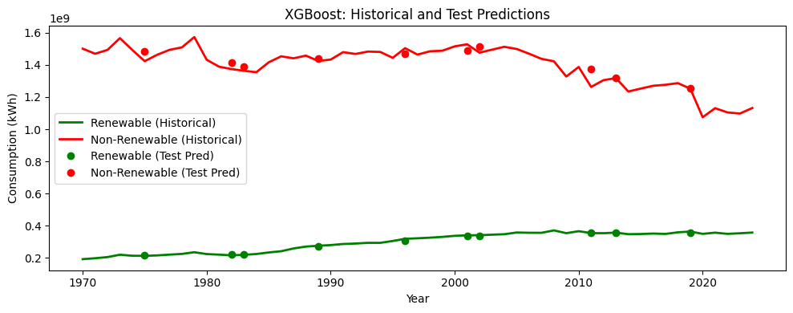](../assets/dissertation-gallery/original/dissertation-39.png)

Original saved result, not reproduced. Targets and absolute unit scale need correction; ARIMA and tree-model splits are not matched. Shuffled holdouts, tuning and predictor timing prevent an independently verified model ranking. Feature importance is model-specific association, not causal influence.

Dissertation rId39; paragraph(s) 471. Notebook cell 146, output 0. 

### XGBoost actual versus predicted

**Original research figure; not reproduced**

[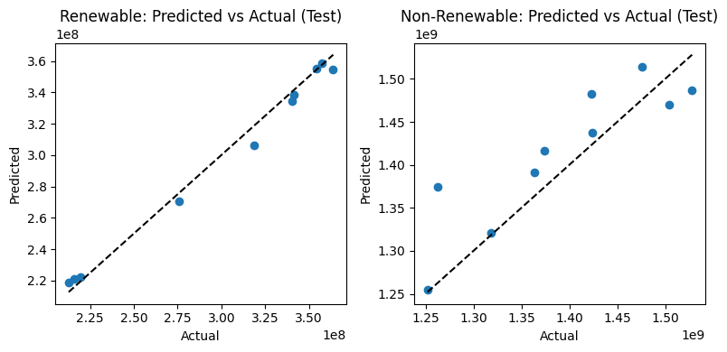](../assets/dissertation-gallery/original/dissertation-40.png)

Original saved result, not reproduced. Targets and absolute unit scale need correction; ARIMA and tree-model splits are not matched. Shuffled holdouts, tuning and predictor timing prevent an independently verified model ranking. Feature importance is model-specific association, not causal influence.

Dissertation rId40; paragraph(s) 473, 666. Notebook cell 148, output 0. 

### XGBoost feature importance

**Original research figure; not reproduced**

[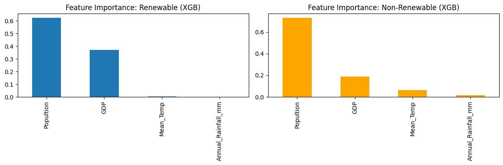](../assets/dissertation-gallery/original/dissertation-41.png)

Original saved result, not reproduced. Targets and absolute unit scale need correction; ARIMA and tree-model splits are not matched. Shuffled holdouts, tuning and predictor timing prevent an independently verified model ranking. Feature importance is model-specific association, not causal influence.

Dissertation rId41; paragraph(s) 482, 668. 

Original forecasting illustrations (7)

### ARIMA historical series and forecast bars

**Original research figure; not reproduced**

[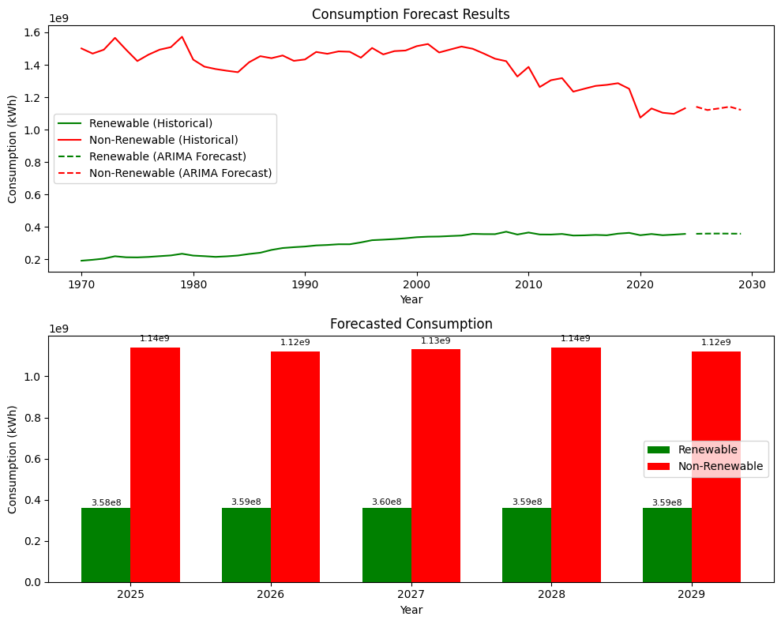](../assets/dissertation-gallery/original/dissertation-33.png)

Original forecast illustration, not reproduced or validated. Original target definitions, unit scale and future predictor assumptions are unresolved. With observations through 2024, the five-year scenario is 2025–2029; it is not a verified 2030 forecast or a calibrated uncertainty interval.

Dissertation rId33; paragraph(s) 410, 413, 653, 655. Notebook cell 99, output 0. 

### Original target-group forecast comparison bars

**Original research figure; not reproduced**

[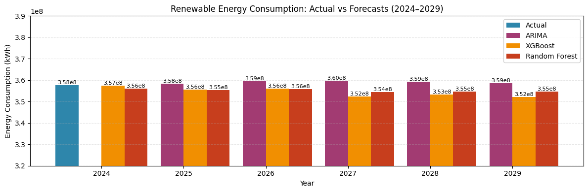](../assets/dissertation-gallery/original/dissertation-42.png)

Original forecast illustration, not reproduced or validated. Original target definitions, unit scale and future predictor assumptions are unresolved. With observations through 2024, the five-year scenario is 2025–2029; it is not a verified 2030 forecast or a calibrated uncertainty interval.

Dissertation rId42; paragraph(s) 494. Notebook cell 169, output 0. 

### Original second target-group forecast bars

**Original research figure; not reproduced**

[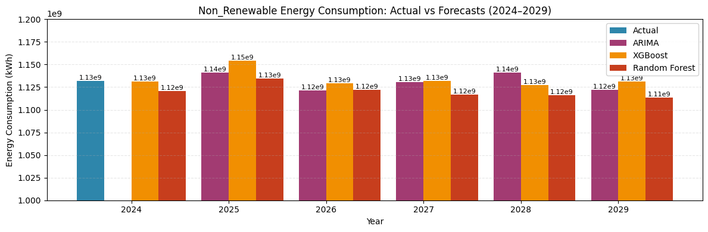](../assets/dissertation-gallery/original/dissertation-43.png)

Original forecast illustration, not reproduced or validated. Original target definitions, unit scale and future predictor assumptions are unresolved. With observations through 2024, the five-year scenario is 2025–2029; it is not a verified 2030 forecast or a calibrated uncertainty interval.

Dissertation rId43; paragraph(s) 495. Notebook cell 170, output 0. 

### Model forecast overlay in the dissertation body

**Original research figure; not reproduced**

[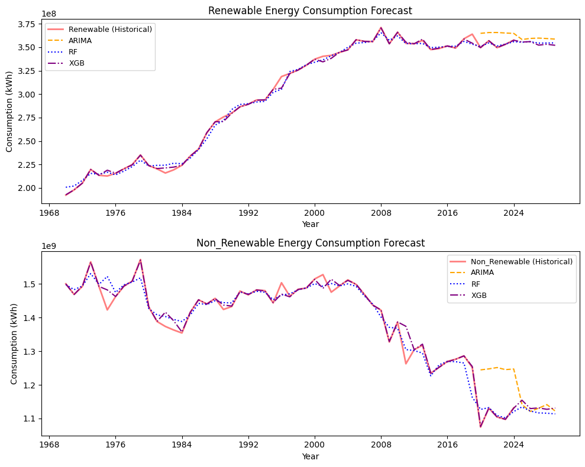](../assets/dissertation-gallery/original/dissertation-44.png)

Original forecast illustration, not reproduced or validated. Original target definitions, unit scale and future predictor assumptions are unresolved. With observations through 2024, the five-year scenario is 2025–2029; it is not a verified 2030 forecast or a calibrated uncertainty interval.

Dissertation rId44; paragraph(s) 499. Notebook cell 167, output 0. 

### Random Forest historical, test and future curves

**Original research figure; not reproduced**

[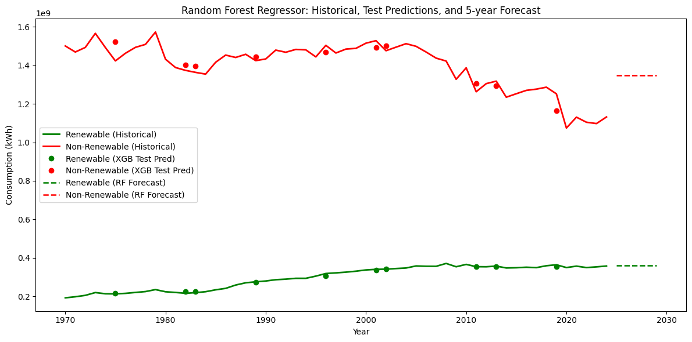](../assets/dissertation-gallery/original/dissertation-69.png)

Original forecast illustration, not reproduced or validated. Original target definitions, unit scale and future predictor assumptions are unresolved. With observations through 2024, the five-year scenario is 2025–2029; it is not a verified 2030 forecast or a calibrated uncertainty interval.

Dissertation rId69; paragraph(s) 661. 

### XGBoost historical, test and future curves

**Original research figure; not reproduced**

[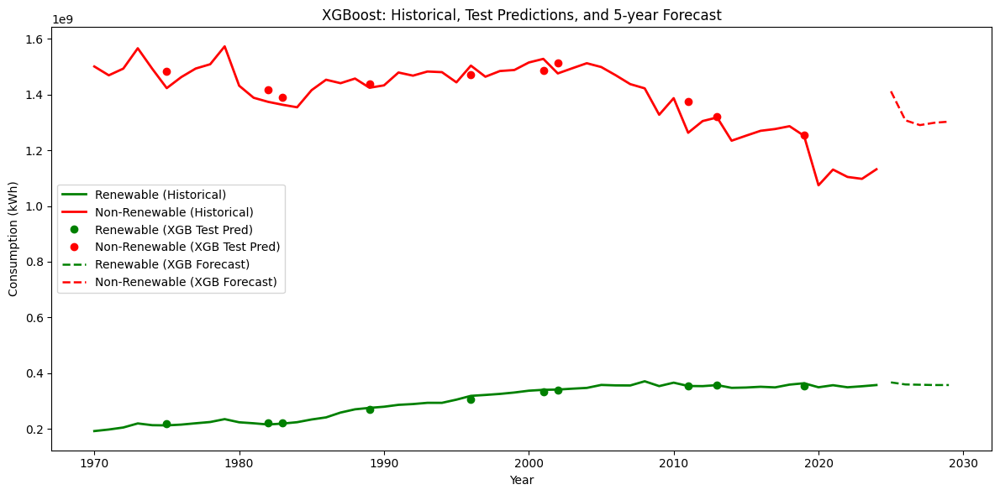](../assets/dissertation-gallery/original/dissertation-70.png)

Original forecast illustration, not reproduced or validated. Original target definitions, unit scale and future predictor assumptions are unresolved. With observations through 2024, the five-year scenario is 2025–2029; it is not a verified 2030 forecast or a calibrated uncertainty interval.

Dissertation rId70; paragraph(s) 671. 

### ARIMA forecast image under the final comparison caption

**Original research figure; not reproduced**

[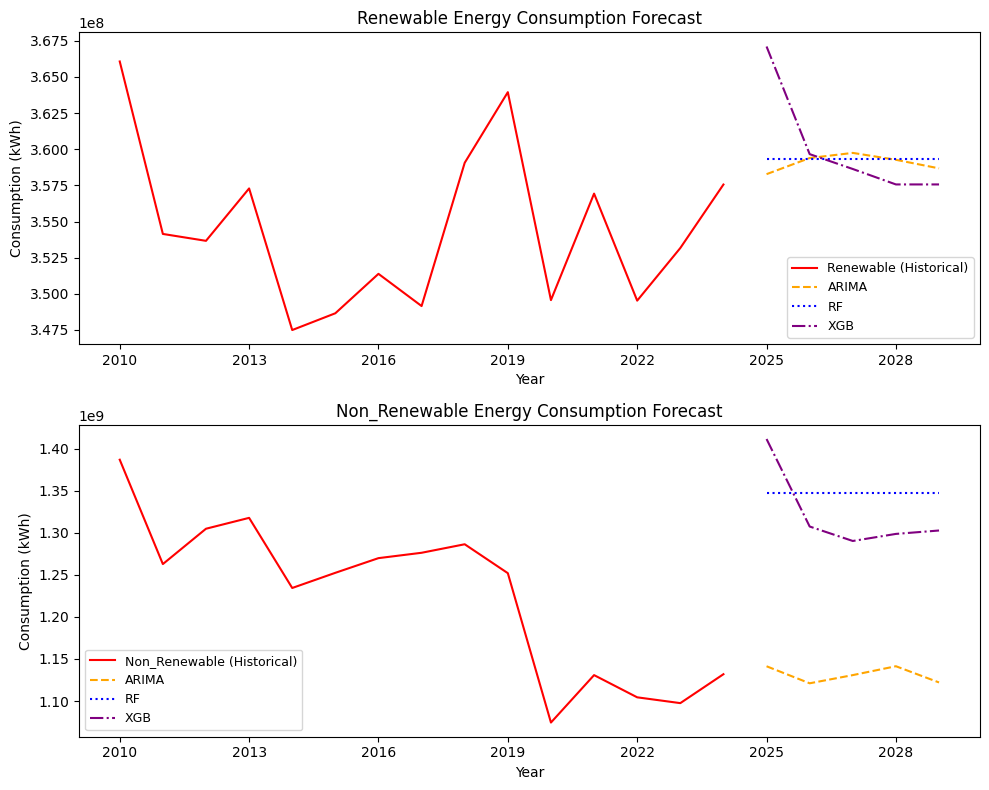](../assets/dissertation-gallery/original/dissertation-71.png)

Original forecast illustration, not reproduced or validated. Original target definitions, unit scale and future predictor assumptions are unresolved. With observations through 2024, the five-year scenario is 2025–2029; it is not a verified 2030 forecast or a calibrated uncertainty interval.

Dissertation rId71; paragraph(s) 674. 

Additional notebook plots and alternate renderings (16)

### Sector consumption trends

**Original saved notebook plot; not rerun**

[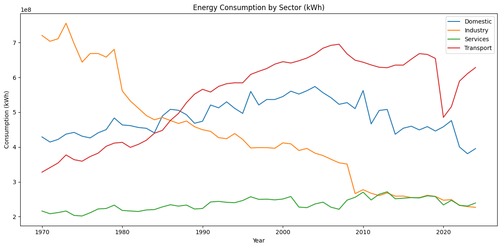](../assets/dissertation-gallery/original/notebook-30-0.png)

Original figure, not reproduced. The notebook mislabels ktoe × 11,630 as kWh and some preparation fills missing cells with zero or merges fuel categories. See the separately validated charts for corrected units and scope.

Notebook cell 30, output 0. 

### National fuel consumption

**Original saved notebook plot; not rerun**

[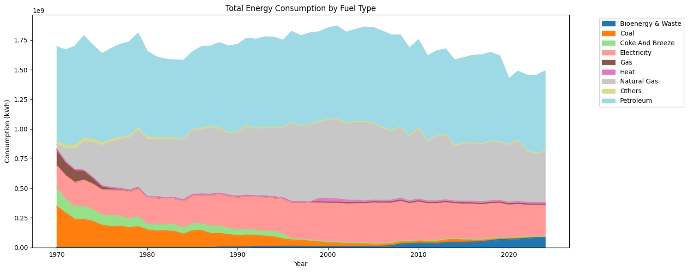](../assets/dissertation-gallery/original/notebook-36-0.png)

Original figure, not reproduced. The notebook mislabels ktoe × 11,630 as kWh and some preparation fills missing cells with zero or merges fuel categories. See the separately validated charts for corrected units and scope.

Notebook cell 36, output 0. 

### Fuel mix snapshot

**Original saved notebook plot; not rerun**

[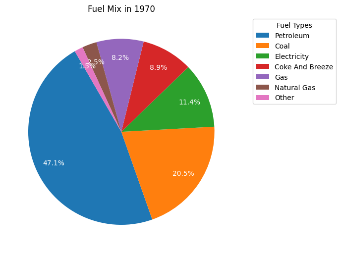](../assets/dissertation-gallery/original/notebook-40-0.png)

Original figure, not reproduced. The notebook mislabels ktoe × 11,630 as kWh and some preparation fills missing cells with zero or merges fuel categories. See the separately validated charts for corrected units and scope.

Notebook cell 40, output 0. 

### Fuel mix snapshot

**Original saved notebook plot; not rerun**

Original figure, not reproduced. The notebook mislabels ktoe × 11,630 as kWh and some preparation fills missing cells with zero or merges fuel categories. See the separately validated charts for corrected units and scope.

Notebook cell 40, output 1. 

### Fuel mix snapshot

**Original saved notebook plot; not rerun**

Original figure, not reproduced. The notebook mislabels ktoe × 11,630 as kWh and some preparation fills missing cells with zero or merges fuel categories. See the separately validated charts for corrected units and scope.

Notebook cell 40, output 2. 

### Year-on-year sector changes

**Original saved notebook plot; not rerun**

Original figure, not reproduced. The notebook mislabels ktoe × 11,630 as kWh and some preparation fills missing cells with zero or merges fuel categories. See the separately validated charts for corrected units and scope.

Notebook cell 46, output 0. 

### Correlation across aggregated fuel profiles

**Original saved notebook plot; not rerun**

Original figure, not reproduced. The notebook mislabels ktoe × 11,630 as kWh and some preparation fills missing cells with zero or merges fuel categories. See the separately validated charts for corrected units and scope.

Notebook cell 49, output 0. 

### Major fuel trends

**Original saved notebook plot; not rerun**

Original figure, not reproduced. The notebook mislabels ktoe × 11,630 as kWh and some preparation fills missing cells with zero or merges fuel categories. See the separately validated charts for corrected units and scope.

Notebook cell 52, output 1. 

### Original two-target area chart

**Original saved notebook plot; not rerun**

Original figure, not reproduced. The Renewable label combines all electricity with bioenergy and waste; this is not measured renewable consumption. Original predictor indicator/vintage files are missing. Correlation is not causation.

Notebook cell 67, output 0. 

### GDP or population scatter plots

**Original saved notebook plot; not rerun**

Original figure, not reproduced. The Renewable label combines all electricity with bioenergy and waste; this is not measured renewable consumption. Original predictor indicator/vintage files are missing. Correlation is not causation.

Notebook cell 85, output 0. 

### GDP or population scatter plots

**Original saved notebook plot; not rerun**

Original figure, not reproduced. The Renewable label combines all electricity with bioenergy and waste; this is not measured renewable consumption. Original predictor indicator/vintage files are missing. Correlation is not causation.

Notebook cell 85, output 1. 

### Temperature scatter plots

**Original saved notebook plot; not rerun**

Original figure, not reproduced. The Renewable label combines all electricity with bioenergy and waste; this is not measured renewable consumption. Original predictor indicator/vintage files are missing. Correlation is not causation.

Notebook cell 86, output 0. 

### Rainfall scatter plots

**Original saved notebook plot; not rerun**

Original figure, not reproduced. The Renewable label combines all electricity with bioenergy and waste; this is not measured renewable consumption. Original predictor indicator/vintage files are missing. Correlation is not causation.

Notebook cell 87, output 0. 

### Original feature correlation matrix

**Original saved notebook plot; not rerun**

Original figure, not reproduced. The Renewable label combines all electricity with bioenergy and waste; this is not measured renewable consumption. Original predictor indicator/vintage files are missing. Correlation is not causation.

Notebook cell 88, output 0. 

### Random Forest feature importance

**Original saved notebook plot; not rerun**

Original saved result, not reproduced. Targets and absolute unit scale need correction; ARIMA and tree-model splits are not matched. Shuffled holdouts, tuning and predictor timing prevent an independently verified model ranking. Feature importance is model-specific association, not causal influence.

Notebook cell 125, output 0. 

### XGBoost feature importance

**Original saved notebook plot; not rerun**

Original saved result, not reproduced. Targets and absolute unit scale need correction; ARIMA and tree-model splits are not matched. Shuffled holdouts, tuning and predictor timing prevent an independently verified model ranking. Feature importance is model-specific association, not causal influence.

Notebook cell 150, output 0. 

## Inventory and discrepancies

The appendix repeats Figure 31. Figures 14/15, 16/17, 18/19 and 20/21 reuse two-panel scatter images. Figures 23/24 share one ARIMA image. The final caption says model comparison but references an ARIMA-only image; the actual multi-model overlay is recovered separately as doc-44. All 32 caption-to-image references are recorded without silently renumbering or correcting the originals.

Notebook cell 49 correlates fuel profiles aggregated over years, not the annual sector totals used in the new verified correlation figure. Neither matrix proves causation. Original future-scenario plots and bars also have period/target limitations described in their captions.

## Reproduction

`python src/build_visual_gallery.py` traces plotted historical values to source workbook cells and checks annual changes, correlations and matched model errors. `python src/render_visual_gallery.py` regenerates this gallery. `python src/check_visual_gallery.py` verifies manifests and image integrity. Dependencies are in requirements-ci.txt; model fitting is not rerun by the gallery builder.

To recover the originals again, supply private source paths to `python src/recover_visuals.py --dissertation <report.docx> --notebook <archive.zip>`. The original documents are deliberately not included. Inventory cell/paragraph/output indices are zero-based.
